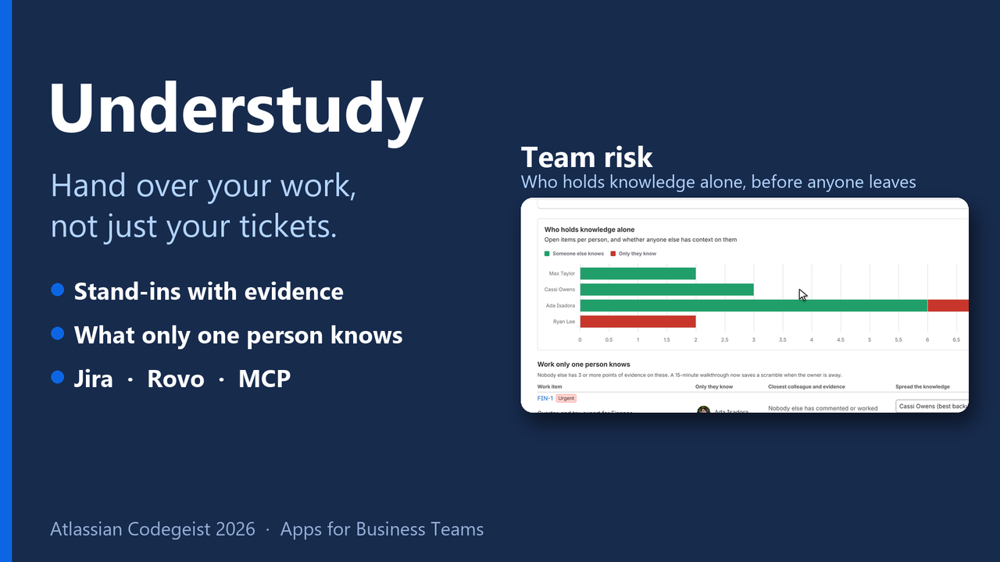

# Understudy

**Hand over your work without losing its context.**

When someone goes on holiday, parental leave or a conference, their work doesn't stop needing them. Today the handover is a rushed doc written the night before: it misses the item only they understood, it dumps everything on the one expert, and nobody tells the stand-ins *why* they were picked. When the person comes back, they spend a morning reconstructing what happened.

Understudy is a Forge app for Jira and Confluence, with a Rovo agent, that uses Atlassian's connected context (Jira, Confluence and the Teamwork Graph) to plan the handover and the handback:

- **Before you go:** it ranks your open work by what must be covered, suggests a stand-in for each item with the evidence for that choice, spreads the load so the expert is not buried, and flags the work **only you have context on**. One click briefs each stand-in on the work item; another publishes the handover page in Confluence.
- **Welcome back:** it shows what changed on your work while you were away, with the items that need you first (mentions, items handed to you, replies waiting) and which stand-in covered what.
- **Team risk:** before anyone goes away, it finds the work only one person understands across up to 5 projects, shows how ready the team is to cover each person, and asks the owner for a 15-minute walkthrough with the colleague best placed to learn it.

It works in four places: a Jira page with three tabs, a panel on every work item, a Rovo agent with three reusable skills, and an MCP server with eight tools that any MCP client can call.

---

## Demo video

[](https://youtu.be/s1VzERdO49g)

The live app on a real Atlassian site: build a handover, the evidence behind each stand-in, the warning for what only the person knows, briefing and publishing, the work item panel, the Rovo agent, MCP and Welcome back (2:48). The video was recorded before the Team risk tab; a new cut will be linked here when ready.

## What it does

| Where | What you get |
| --- | --- |
| **Jira › Apps › Understudy › Before you go** | Pick a person and dates. See the headline ("Ada Isadora has 7 open items: 4 must be covered from 12 Nov 2026, 2 fall due by 14 Nov 2026, 1 already overdue, 1 only Ada Isadora has context on"), the cover plan, who covers what, code in flight, goals, pages. Change any stand-in, brief them, publish the page. Briefing the same stand-in again updates your earlier briefing comment instead of adding a second one. |
| **Jira › Apps › Understudy › Welcome back** | What changed since your first day away, needs-you items first, and who covered what. |
| **Jira › Apps › Understudy › Team risk** | Pick up to 5 projects and **Check knowledge risk**. See the single points of knowledge (work nobody but its owner could pick up today), cover readiness for the team and per person, the closest colleague for each item, and a **Request walkthrough** button. |
| **Work item › Understudy panel** | "If Ada Isadora is away, who could cover PAY-2?" Top three people with reasons, one-click briefing. |
| **Rovo chat › Understudy agent** | "Prepare my handover for next week", "Who should cover this?", "I'm back, what needs me first?", "Where is our team's knowledge held by one person?" |
| **Rovo Studio and MCP clients** | Eight tools (`get-handover-brief`, `suggest-stand-ins`, `publish-handover-page`, `brief-stand-in`, `brief-all-stand-ins`, `get-welcome-back-brief`, `get-team-knowledge-risk`, `request-walkthrough`) and three open `SKILL.md` playbooks (`handover-planner`, `welcome-back`, `knowledge-risk`). |

In Rovo chat, `publish-handover-page` and `brief-all-stand-ins` accept the stand-ins chosen in the conversation (`standIns`, such as "PAY-3=Max Taylor; PAY-5=Cassi Owens"), so a plan edited in chat is the plan that gets published and briefed. `brief-all-stand-ins` briefs every stand-in in the plan with one confirmation; `get-team-knowledge-risk` takes `projects` (comma-separated keys, empty for the projects of your own open work) and `request-walkthrough` takes `issueKey`, `learner` and `note`.

### Evidence, not magic

Every suggestion comes with reasons a person can check in Jira. Points per candidate and work item:

| Evidence | Points |
| --- | --- |
| Commented on this work item | 3 per comment, up to 9 |
| Reported it | 2 |
| Worked on other items in the same epic or parent | 3 each, up to 6 |
| Works on the same components | 1 each, up to 3 |
| Works with the same labels | 1 each, up to 2 |
| Recent items in the same project | 1 each, up to 3 |
| In one of the person's Atlassian teams (Teamwork Graph) | 1 |
| Already carries more than 5 open items | −0.5 per extra item, up to −6 |

Items are handled in order of urgency (overdue, due while away, blocked, high priority, open pull request, someone waiting for a reply, in progress), and every assignment adds to that stand-in's load, so the plan balances itself. An item whose best stand-in has fewer than 3 points of context is flagged as **only you know this**: it needs a walkthrough, not just a reassignment. When everyone with context is already overloaded (load penalty larger than their context), Understudy suggests nobody and asks a person to pick.

Only active people count: apps such as Automation for Jira, service desk customers and deactivated accounts are never suggested, and Understudy's own briefing and walkthrough comments are not counted as evidence. When someone has more open items than Understudy reads at once (100), the plan covers the most urgent ones and says so.

### Team risk: single points of knowledge

The same evidence, applied to a team before anyone goes away. Pick up to 5 projects: Understudy checks every open assigned work item in them (up to the 100 most urgent) and finds the single points of knowledge, the items where nobody else has 3 or more points of evidence.

On the Forge demo site, for the projects PAY, OPS and FIN, the headline reads: "Only one person has context on 3 of the 14 open items in PAY, OPS, FIN, 2 of them due or urgent in the next two weeks. Ryan Lee holds the most: 2 of 2 items." **Cover readiness** is 79%: the share of open work someone else could pick up today.

- **Tiles:** open items checked, only one person knows, of those urgent soon (due or urgent in the next two weeks), people with open work.
- **Who holds knowledge alone:** a stacked bar chart with, per person, the items someone else knows and the items only they know.
- **Work only one person knows:** each item with its owner, the closest colleague and that colleague's evidence, and a **Request walkthrough** button.
- **People:** cover readiness per person and their best backup ("Could cover 3 of 5 today").

**Request walkthrough** posts a comment on the work item that @-mentions the owner and asks for a 15-minute walkthrough with the chosen colleague, and adds the colleague as a watcher. The row then shows "Walkthrough asked for *name*". Nothing is reassigned. The comment is signed "Requested with Understudy." and is never counted as evidence.

The handover's "only you know this" warning counts only work that must be covered while the person is away; the team view counts every open item, including work that can wait. So the team view's numbers can be higher.

## How it differs

- **Out-of-office apps** on the Marketplace make you name a coverer in advance and then reassign by rule. Understudy suggests a stand-in for each work item from evidence anyone can check in Jira, and shows why.
- **Rules move tickets.** Understudy changes no assignee. It finds the work only you understand, so it gets a walkthrough instead of a silent reassignment, and spreads the load so your one expert is not buried.
- **Chat assistants** summarize what you missed after you return. Understudy plans the cover before you leave, briefs each stand-in on the work item itself, publishes the handover page, and then closes the loop when you are back.
- **Before anyone leaves.** Out-of-office apps act once someone is away; none we found on the Marketplace shows a team's single points of knowledge before anyone leaves. Team risk does, per project and per person, and turns each one into a walkthrough request.

## How it is built

```
            Jira page (UI Kit)     Work item panel (UI Kit)     Rovo agent + 3 skills     MCP clients
                    │                        │                           │                     │
                    └──────── resolvers ─────┘                           └────── 8 actions ────┘
                                       │                                          │
                                       └──────────────── service.ts ──────────────┘
                                                            │
                          ┌─────────────────────────────────┼─────────────────────────────┐
                    core/ (pure, tested)              adapters/gather.ts              adapters/twg.ts
              risk · stand-ins · plan · render     Jira REST · Confluence REST     Teamwork Graph curated
                       team · handback                                            queries (asUser)
```

- **Forge modules:** `jira:globalPage` (three tabs), `jira:issuePanel`, `rovo:agent`, `rovo:skill` ×3, `rovo:mcp`, `action` ×8. Runtime `nodejs24.x`.
- **Teamwork Graph API** (curated queries, no Cypher to register): the person's teams and teammates (`atlassianUserInTeams`, `atlassianTeamMembers`), their pull requests (`atlassianUserPullRequests`), pull requests linked to each work item (`jiraWorkItemLinkedExternalPullRequests`, batched with aliases), and goals and projects (`atlassianUserGoalsAndProjects`). Each query has a plainer fallback, and each source reports its own state in the sources line (connected, no data, not available), so a missing scope or an empty graph never fails the handover. On the Forge demo site used for the video, the graph returned no data for the fictional users and intermittently refused reads with "User is not permitted to query this organization" (a known demo-site issue, reported on the Atlassian developer community). The app now retries that error up to 3 times with backoff and then shows "Teamwork Graph no data" honestly; the demo does not show graph evidence.
- **Jira REST:** enhanced JQL search (with `expand=changelog` for Welcome back), users, comments with @-mentions in ADF (added, or updated for a repeat briefing), watchers.
- **Confluence REST:** CQL search for recent pages, v2 spaces and pages to publish the handover.
- **Everything runs as the user** (`asUser`), so nobody sees work they couldn't already open. The graph is read-only. Understudy writes only when a person confirms: a comment, a watcher, or a page. It stores nothing and calls no external service. Details in [PRIVACY.md](PRIVACY.md).

## Install and test (for judges)

1. Open the installation link from the Devpost submission and install Understudy on your Jira site. When asked, also connect it to Confluence on the same site (optional: needed only to publish handover pages and list recent pages).
2. **Grant the Teamwork Graph scopes** (site or org admin): Atlassian Administration › Apps › Sites › *your site* › Connected apps › Understudy › Permissions, and make sure the `read:graph:*` scopes are on. Without them the app still works from Jira and Confluence, and its sources line shows "Teamwork Graph not available".
3. In Jira, open **Apps › Understudy**. On **Before you go**, keep yourself (or pick a teammate) and dates, then **Build handover**.
4. On **Team risk**, choose up to 5 projects and press **Check knowledge risk**. **Request walkthrough** posts a comment on that work item.
5. Open any work item and expand the **Understudy** panel.
6. Open **Rovo chat**, choose the **Understudy** agent and try a conversation starter.
7. Optional, MCP: Atlassian Administration › Apps › Sites › *your site* › Connected apps › Understudy › turn on the tools for external MCP clients, then add `https://mcp.atlassian.com/forge/<appId>` to your MCP client. The three playbooks in [`skills/`](skills) can be given to that client as skills.

Need data? `scripts/seed-demo.mjs` creates a small fictional team's work on a development site (three projects, an epic, due dates relative to today, a blocking link and comments). Read its header, then run it with your own API token.

## Develop

Requirements: Node.js 22.23.4+ or 24.22.1+ for the latest Forge CLI (this repo pins `@forge/cli` 14.2.0, which runs on Node 20.18+), and an Atlassian account.

```bash
npm install
npm run check          # TypeScript + 80 unit tests
npx forge login        # your Atlassian email and API token
npx forge register     # writes the real app id into manifest.yml
npx forge deploy
npx forge install --site <your-site>.atlassian.net --product jira
npx forge install --site <your-site>.atlassian.net --product confluence   # optional
```

`src/core` holds the logic with no Forge imports, tested in `test/`. `src/adapters` talk to Atlassian APIs, `src/service.ts` composes them for both the UI resolvers and the Rovo actions.

## Licence

MIT
